# Payment Ruby SDK (`Payment::SDK`)

[](https://www.ruby-lang.org)
[](docs/ARCHITECTURE.md)
[](test/)
[](test/)
[](docs/audit/001-codebase_technical_audit.md)
[](LICENSE)

SDK idiomático en Ruby de **grado enterprise y cero dependencias externas**, diseñado bajo los principios de **Clean Architecture**, **Hexagonal Architecture (Ports & Adapters)**, **Domain-Driven Design (DDD)**, **Bounded Contexts**, y segregación **CQRS**.

---

## Índice

1. [Visión General y Principios de Diseño](#1-visión-general-y-principios-de-diseño)
2. [Arquitectura del Sistema (Context-First)](#2-arquitectura-del-sistema-context-first)
3. [Instalación](#3-instalación)
4. [Configuración Segura y Resiliencia](#4-configuración-segura-y-resiliencia)
5. [Guía de Integración por Bounded Context](#5-guía-de-integración-por-bounded-context)
   - [5.1 Bounded Context: Pagos (`payments`)](#51-bounded-context-pagos-payments)
   - [5.2 Bounded Context: Reembolsos (`refunds`)](#52-bounded-context-reembolsos-refunds)
   - [5.3 Bounded Context: Webhooks con Transactional Inbox (`webhooks`)](#53-bounded-context-webhooks-con-transactional-inbox-webhooks)
   - [5.4 Bounded Context: Conciliación Financiera (`reconciliation`)](#54-bounded-context-conciliación-financiera-reconciliation)
6. [Manejo de Errores y Tipado de Excepciones](#6-manejo-de-errores-y-tipado-de-excepciones)
7. [Concurrencia y Thread-Safety](#7-concurrencia-y-thread-safety)
8. [Auditoría Técnica y Buenas Prácticas](#8-auditoría-técnica-y-buenas-prácticas)
9. [Guía de Desarrollo y Pruebas](#9-guía-de-desarrollo-y-pruebas)

---

## 1. Visión General y Principios de Diseño

El `Payment::SDK` proporciona a plataformas financieras y servicios e-commerce una capa cliente robusta, predecible y altamente mantenible:

- **Cero Dependencias Externas:** Construido 100% sobre la biblioteca estándar de Ruby (`net/http`, `openssl`, `json`).
- **Organización Context-First:** Cada Bounded Context encapsula físicamente su propio `domain/`, `application/` e `interfaces/`.
- **Protocolo Invocable `#call` Estándar:** Todos los comandos, consultas y casos de uso implementan la interfaz funcional `#call`, unificando la ergonomía de Ruby.
- **Normalización a Symbols:** Los estados del dominio (`:succeeded`, `:requires_capture`, `:failed`, etc.) son símbolos inmutables para comparaciones $O(1)$ eficientes.
- **Idempotencia Mandatoria:** Toda mutación de saldo exige una clave de idempotencia validada desde el dominio.
- **Deduplicación de Webhooks:** Patrón *Transactional Inbox* integrado con validación de firmas criptográficas HMAC-SHA256 resistente a ataques de temporización (*timing attacks*).

---

## 2. Arquitectura del Sistema (Context-First)

```mermaid
graph TD
    subgraph DrivingAdapters ["Driving / Primary Adapters (Interfaces)"]
        PaymentsClient["Payments::Interfaces::Client"]
        RefundsClient["Refunds::Interfaces::Client"]
        WebhooksClient["Webhooks::Interfaces::Client"]
        ReconciliationClient["Reconciliation::Interfaces::Client"]
    end

    subgraph ClientFacade ["Client Facade"]
        GlobalClient["Payment::SDK::Client"]
    end

    subgraph ApplicationLayer ["Application Layer (CQRS & Use Cases with #call)"]
        PaymentsApp["payments/application/ (commands & queries)"]
        RefundsApp["refunds/application/ (commands & queries)"]
        WebhooksApp["webhooks/application/ (use_cases/process)"]
        ReconciliationApp["reconciliation/application/ (use_cases/reconcile, queries)"]
        SharedApp["shared/application/ (BaseCommand, BaseQuery)"]
    end

    subgraph DomainLayer ["Domain Layer (Pure Core with Symbols)"]
        PaymentsDomain["payments/domain/ (Entities: PaymentIntent, PaymentAttempt, Charge)"]
        RefundsDomain["refunds/domain/ (Entities: Refund)"]
        WebhooksDomain["webhooks/domain/ (Entities: WebhookEvent, Ports: Inbox::Store, Signature::Verifier)"]
        ReconciliationDomain["reconciliation/domain/ (Ports: Snapshot::Store, Mismatch::Reporter)"]
        SharedDomain["shared/domain/ (ValueObjects: Money, Currency, IdempotencyKey, Ports: Http::Client)"]
    end

    subgraph DrivenAdapters ["Driven / Secondary Adapters (Infrastructure)"]
        NetHttp["Infrastructure::Adapters::Http::Client::NetHttp"]
        ErrorMapper["Infrastructure::Adapters::Http::ErrorMapper"]
        HmacVerifier["Infrastructure::Adapters::Crypto::Signature::Verifier::HmacSha256"]
        InMemoryInbox["Infrastructure::Adapters::Persistence::Inbox::Store::InMemory"]
        InMemorySnapshot["Infrastructure::Adapters::Persistence::Snapshot::Store::InMemory"]
        InMemoryMismatch["Infrastructure::Adapters::Reporting::Mismatch::Reporter::InMemory"]
        WebhookParser["Infrastructure::Adapters::Webhooks::EventParser"]
    end

    GlobalClient --> PaymentsClient
    GlobalClient --> RefundsClient
    GlobalClient --> WebhooksClient
    GlobalClient --> ReconciliationClient

    PaymentsClient --> PaymentsApp
    RefundsClient --> RefundsApp
    WebhooksClient --> WebhooksApp
    ReconciliationClient --> ReconciliationApp

    PaymentsApp --> PaymentsDomain
    PaymentsApp --> NetHttp
    RefundsApp --> RefundsDomain
    RefundsApp --> NetHttp
    WebhooksApp --> WebhooksDomain
    ReconciliationApp --> ReconciliationDomain

    DrivenAdapters -.->|Implements Ports| DomainLayer
```



---

## 3. Instalación

Agrega la gema a tu `Gemfile`:

```ruby
gem "payment-sdk", "~> 0.1.0"
```

O instálala directamente vía terminal:

```bash
gem install payment-sdk
```

---

## 4. Configuración Segura y Resiliencia

Configura el SDK globalmente en el arranque de tu aplicación (por ejemplo en `config/initializers/payment_sdk.rb`):

```ruby
require "payment/sdk"

Payment::SDK.configure do |config|
  config.api_key        = ENV.fetch("PAYMENT_API_KEY")
  config.signing_secret = ENV.fetch("PAYMENT_SIGNING_SECRET")
  config.base_url       = ENV.fetch("PAYMENT_BASE_URL", "https://api.payment.com")
  config.timeout        = 10 # Tiempo máximo de espera de lectura HTTP (segundos)
  config.open_timeout   = 5  # Tiempo máximo de apertura de conexión socket (segundos)
  config.max_retries    = 3  # Reintentos automáticos con backoff exponencial y jitter
end
```

### Instanciación del Cliente
Puedes utilizar el singleton preconfigurado o instanciar clientes aislados (ideal para arquitecturas multi-tenant):

```ruby
# Cliente global con configuración por defecto
client = Payment::SDK::Client.new

# Cliente aislado con configuración específica
custom_config = Payment::SDK::Configuration.new
custom_config.api_key = "sk_live_custom_tenant_key"
custom_client = Payment::SDK::Client.new(configuration: custom_config)
```

---

## 5. Guía de Integración por Bounded Context

### 5.1 Bounded Context: Pagos (`payments`)

Manejo del ciclo de vida de cobros, autorizaciones diferidas y capturas:

```ruby
# 1. Crear un intento de pago (PaymentIntent)
intent = client.payments.create_intent(
  amount: 5000,                                 # $50.00 USD (en centavos enteros)
  currency: "usd",
  customer_id: "cus_987654",
  merchant_id: "mer_123456",
  capture_method: "manual",                     # 'manual' o 'automatic'
  idempotency_key: "checkout_order_45892_token" # Obligatorio para mutaciones
)

puts "Intent ID: #{intent.id}, Status: #{intent.status}" # :requires_confirmation

# 2. Confirmar el pago con un método suministrado
confirmed = client.payments.confirm_intent(
  intent_id: intent.id,
  payment_method_id: "pm_card_visa_tok",
  idempotency_key: "confirm_order_45892_token"
)

if confirmed.requires_capture?
  # 3. Capturar fondos previamente autorizados
  captured = client.payments.capture_intent(
    intent_id: intent.id,
    amount_to_capture: 5000,
    idempotency_key: "capture_order_45892_token"
  )
  puts "Pago exitoso: #{captured.succeeded?}" # true
end

# 4. Consultas de solo lectura (CQS Read)
current_intent = client.payments.get_intent(id: intent.id)
charge_detail  = client.payments.get_charge(id: "ch_abc123")
attempts_list  = client.payments.list_attempts(intent_id: intent.id)
lifecycle_view = client.payments.get_lifecycle(intent_id: intent.id)
```

---

### 5.2 Bounded Context: Reembolsos (`refunds`)

Gestión de devoluciones totales o parciales sobre cargos efectuados:

```ruby
# 1. Emitir un reembolso sobre un Charge existente
refund = client.refunds.create_refund(
  charge_id: "ch_abc123",
  amount: 2500,                         # Reembolso parcial de $25.00 USD
  reason: "customer_requested_return",
  idempotency_key: "refund_tx_99812_token"
)

puts "Refund ID: #{refund.id}, Status: #{refund.status}" # :succeeded
puts "Reembolso completado: #{refund.succeeded?}"        # true

# 2. Consultar un reembolso por ID
fetched_refund = client.refunds.get_refund(id: refund.id)
```

---

### 5.3 Bounded Context: Webhooks con Transactional Inbox (`webhooks`)

Procesamiento seguro de eventos entrantes garantizando deduplicación exacta (*Exactly-Once delivery semantics*) y protección anti-timing attacks:

```ruby
# En tu controlador web (ej. Rails, Sinatra, Roda):
payload_raw = request.raw_post
signature   = request.headers["HTTP_X_SIGNATURE_256"]
delivery_id = request.headers["HTTP_X_DELIVERY_ID"]

# El caso de uso Process orquesta verificación HMAC, deduplicación en Inbox y ejecución
result = client.webhooks.process_event(
  raw_payload: payload_raw,
  signature: signature,
  delivery_id: delivery_id
) do |event|
  # Este bloque SOLO se ejecuta si la firma es válida y el evento NO fue procesado antes
  case event.event_type
  when "payment_intent.succeeded"
    OrderFulfillmentJob.perform_later(event.payment_intent_id)
  when "charge.refunded"
    AccountingLedger.record_refund(event.charge_id, event.refund_id)
  end
end

case result[:status]
when :processed
  render status: 200, json: { status: "processed" }
when :duplicate
  render status: 200, json: { status: "already_processed" }
when :rejected_signature
  render status: 401, json: { error: "Invalid signature" }
else
  render status: 500, json: { error: result[:error] }
end
```

---

### 5.4 Bounded Context: Conciliación Financiera (`reconciliation`)

Auditoría y detección automática de discrepancias entre saldos locales y la plataforma remota:

```ruby
# Comparar el estado local frente a la plataforma remota
report = client.reconciliation.reconcile(
  date: "2026-10-27",
  local_records: [
    { id: "pi_001", amount: 1000, status: "succeeded" },
    { id: "pi_002", amount: 5000, status: "requires_capture" }
  ]
)

if report.clean?
  puts "Conciliación contable exitosa: 0 discrepancias."
else
  puts "Alerta: #{report.mismatch_count} discrepancias detectadas:"
  report.mismatches.each do |mismatch|
    puts "- [#{mismatch[:type]}] ID: #{mismatch[:id]} - Detalle: #{mismatch[:message]}"
  end
end
```

---

## 6. Manejo de Errores y Tipado de Excepciones

Toda falla de transporte o de validación de negocio se asigna a una excepción fuertemente tipada:

```ruby
begin
  client.payments.capture_intent(
    intent_id: "pi_invalid",
    amount_to_capture: 1000,
    idempotency_key: "key_123"
  )
rescue Payment::SDK::AuthenticationError => e
  # Error 401: API Key incorrecta o expirada
  logger.error("Error de autenticación: #{e.message}")
rescue Payment::SDK::InvalidRequestError => e
  # Error 400 / 422: Parámetros inválidos o violación de invariantes
  logger.warn("Petición rechazada (#{e.status_code}): #{e.response_body}")
rescue Payment::SDK::RateLimitError => e
  # Error 429: Cuota de peticiones superada
  sleep(e.retry_after || 5)
  retry
rescue Payment::SDK::APIError => e
  # Error 500..503: Falla en el servidor remoto
  logger.fatal("Falla de plataforma: #{e.message}")
end
```

---

## 7. Concurrencia y Thread-Safety

- **Fachadas y Clientes:** `Payment::SDK::Client` y todos los sub-clientes de contexto son **inmutables y stateless** tras su inicialización. Pueden compartirse de manera segura entre todos los hilos de servidores de alto rendimiento (Puma con múltiples hilos, Falcon) y trabajadores en segundo plano (Sidekiq).
- **Adaptadores en Memoria:** Todos los almacenes en memoria incluidos en el SDK implementan cerrojos atómicos con `Mutex#synchronize` para garantizar seguridad en entornos de test concurrentes.

---

## 8. Auditoría Técnica y Buenas Prácticas

Para un análisis detallado sobre deuda técnica, evaluaciones de rendimiento con Ruby 3.2+ / YJIT, análisis de tiempos de ejecución y plan de evolución, consulta el informe formal:

- 📄 **[Auditoría Técnica y Evaluación de Arquitectura (docs/audit/001-codebase_technical_audit.md)](docs/audit/001-codebase_technical_audit.md)**
- 🌲 **[Estructura Canónica Anotada (TREE.txt)](TREE.txt)**
- 📐 **[Plantilla Arquetípica de Bounded Context (TREE_TEMPLATE.txt)](TREE_TEMPLATE.txt)**

---

## 9. Guía de Desarrollo y Pruebas

### Ejecución de Pruebas Automatizadas

El SDK cuenta con una suite completa de pruebas Minitest con 100% de pasaje:

```bash
# Ejecutar todas las pruebas unitarias y de integración
bundle exec rake test
```

### Convenciones para Contribuciones
1. **Context-First:** Todo nuevo componente debe ubicarse estrictamente dentro de su Bounded Context (`lib/payment/sdk/<context>/`).
2. **Protocolo `#call`:** Comandos, consultas y casos de uso deben responder exclusivamente a `#call`.
3. **Symbols en Dominio:** Entidades y agregados deben exponer y evaluar estados como `Symbols`.
4. **Pruebas Espejo:** Todo archivo nuevo en `lib/` debe tener su correspondiente test en `test/` con el mismo path espejo.

---

## Licencia

Distribuido bajo la licencia MIT. Consulta el archivo `LICENSE` para más información.
