# Payment Ruby SDK (`Payment::SDK`)

[](https://www.ruby-lang.org)
[](docs/ARCHITECTURE.md)
[](test/)
[](docs/audit/001-codebase_technical_audit.md)
[](LICENSE)

SDK idiomático en Ruby de **cero dependencias externas en runtime**, diseñado bajo los principios de **Clean Architecture**, **Hexagonal Architecture (Ports & Adapters)**, **Domain-Driven Design (DDD)**, **Bounded Contexts** y segregación **CQRS**.

---

## Índice

1. [Visión General y Principios de Diseño](#1-visión-general-y-principios-de-diseño)
2. [Arquitectura del Sistema (Context-First)](#2-arquitectura-del-sistema-context-first)
3. [Instalación](#3-instalación)
4. [Configuración Segura y Resiliencia](#4-configuración-segura-y-resiliencia)
5. [Guía de Integración por Bounded Context](#5-guía-de-integración-por-bounded-context)
   - [5.1 Bounded Context: Pagos (`payments`)](#51-bounded-context-pagos-payments)
   - [5.2 Bounded Context: Reembolsos (`refunds`)](#52-bounded-context-reembolsos-refunds)
   - [5.3 Bounded Context: Webhooks con Transactional Inbox (`webhooks`)](#53-bounded-context-webhooks-con-transactional-inbox-webhooks)
   - [5.4 Bounded Context: Conciliación Financiera (`reconciliation`)](#54-bounded-context-conciliación-financiera-reconciliation)
6. [Manejo de Errores y Jerarquía de Excepciones](#6-manejo-de-errores-y-jerarquía-de-excepciones)
7. [Concurrencia y Thread-Safety](#7-concurrencia-y-thread-safety)
8. [Auditoría Técnica y Estructura del Proyecto](#8-auditoría-técnica-y-estructura-del-proyecto)
9. [Guía de Desarrollo, Pruebas y Documentación YARD](#9-guía-de-desarrollo-pruebas-y-documentación-yard)

---

## 1. Visión General y Principios de Diseño

El `Payment::SDK` proporciona una capa cliente modular, predecible y mantenible para integrarse con la API v1 de la plataforma de pagos:

- **Cero Dependencias Externas en Runtime:** Construido 100% sobre la biblioteca estándar de Ruby (`net/http`, `openssl`, `json`, `securerandom`, `time`, `uri`).
- **Organización Context-First:** Cada Bounded Context (`payments`, `refunds`, `webhooks`, `reconciliation`, `shared`) encapsula físicamente su propio `domain/`, `application/` e `interfaces/`.
- **Protocolo Invocable `#call` Estándar:** Todos los comandos (`BaseCommand`), consultas (`BaseQuery`) y casos de uso implementan `#call`.
- **Normalización a Symbols:** Los estados de las entidades de dominio (`:succeeded`, `:requires_capture`, `:failed`, `:pending`, etc.) se normalizan a `Symbol`.
- **Idempotencia Mandatoria en Mutaciones:** Todo comando de mutación exige `idempotency_key` validado mediante el Value Object `Shared::Domain::ValueObjects::IdempotencyKey` e inyectado en el header `Idempotency-Key`.
- **Deduplicación de Webhooks:** Patrón *Transactional Inbox* integrado con verificación criptográfica HMAC-SHA256 en tiempo constante (`OpenSSL.fixed_length_secure_compare`) y validación de ventana temporal (`timestamp_tolerance`).

---

## 2. Arquitectura del Sistema (Context-First)

```mermaid
graph TD
    subgraph DrivingAdapters ["Driving / Primary Adapters (Interfaces)"]
        PaymentsClient["Payments::Interfaces::Client"]
        RefundsClient["Refunds::Interfaces::Client"]
        WebhooksClient["Webhooks::Interfaces::Client"]
        ReconciliationClient["Reconciliation::Interfaces::Client"]
    end

    subgraph ClientFacade ["Client Facade"]
        GlobalClient["Payment::SDK::Client"]
    end

    subgraph ApplicationLayer ["Application Layer (CQRS & Use Cases with #call)"]
        PaymentsApp["payments/application/ (commands & queries)"]
        RefundsApp["refunds/application/ (commands & queries)"]
        WebhooksApp["webhooks/application/ (use_cases/process)"]
        ReconciliationApp["reconciliation/application/ (use_cases/reconcile, queries)"]
        SharedApp["shared/application/ (BaseCommand, BaseQuery)"]
    end

    subgraph DomainLayer ["Domain Layer (Pure Core with Symbols)"]
        PaymentsDomain["payments/domain/ (Entities: PaymentIntent, PaymentAttempt, Charge)"]
        RefundsDomain["refunds/domain/ (Entities: Refund)"]
        WebhooksDomain["webhooks/domain/ (Entities: WebhookEvent, Ports: Inbox::Store, Signature::Verifier)"]
        ReconciliationDomain["reconciliation/domain/ (Ports: Snapshot::Store, Mismatch::Reporter)"]
        SharedDomain["shared/domain/ (ValueObjects: Money, Currency, IdempotencyKey, Concerns: PayloadExtractable, Ports: Http::Client)"]
    end

    subgraph DrivenAdapters ["Driven / Secondary Adapters (Infrastructure)"]
        NetHttp["Infrastructure::Adapters::Http::Client::NetHttp"]
        ErrorMapper["Infrastructure::Adapters::Http::ErrorMapper"]
        HmacVerifier["Infrastructure::Adapters::Crypto::Signature::Verifier::HmacSha256"]
        InMemoryInbox["Infrastructure::Adapters::Persistence::Inbox::Store::InMemory"]
        InMemorySnapshot["Infrastructure::Adapters::Persistence::Snapshot::Store::InMemory"]
        InMemoryMismatch["Infrastructure::Adapters::Reporting::Mismatch::Reporter::InMemory"]
        WebhookParser["Infrastructure::Adapters::Webhooks::EventParser"]
    end

    GlobalClient --> PaymentsClient
    GlobalClient --> RefundsClient
    GlobalClient --> WebhooksClient
    GlobalClient --> ReconciliationClient

    PaymentsClient --> PaymentsApp
    RefundsClient --> RefundsApp
    WebhooksClient --> WebhooksApp
    ReconciliationClient --> ReconciliationApp

    PaymentsApp --> PaymentsDomain
    PaymentsApp --> NetHttp
    RefundsApp --> RefundsDomain
    RefundsApp --> NetHttp
    WebhooksApp --> WebhooksDomain
    ReconciliationApp --> ReconciliationDomain

    DrivenAdapters -.->|Implements Ports| DomainLayer
```



---

## 3. Instalación

Agrega la gema a tu `Gemfile`:

```ruby
gem "payment-sdk", "~> 0.1.0"
```

E instala las dependencias con Bundler:

```bash
bundle install
```

---

## 4. Configuración Segura y Resiliencia

Configura el SDK globalmente en el arranque de tu aplicación (por ejemplo en `config/initializers/payment_sdk.rb`):

```ruby
require "payment/sdk"

Payment::SDK.configure do |config|
  config.api_key        = ENV.fetch("PAYMENT_API_KEY")
  config.signing_secret = ENV.fetch("PAYMENT_SIGNING_SECRET")
  config.base_url       = ENV.fetch("PAYMENT_BASE_URL", "https://api.payment.com")
  config.timeout        = 10 # Read timeout HTTP en segundos (por defecto: 10)
  config.open_timeout   = 5  # Connection timeout en segundos (por defecto: 5)
  config.max_retries    = 2  # Reintentos ante fallos de red/5xx con backoff exponencial y jitter (por defecto: 2)
end
```

### Instanciación del Cliente

Puedes usar la configuración global o pasar una instancia específica de `Payment::SDK::Configuration` (útil para entornos multi-tenant):

```ruby
# Usando la configuración global
client = Payment::SDK::Client.new

# Usando una configuración aislada por tenant
custom_config = Payment::SDK::Configuration.new
custom_config.api_key        = "sk_live_tenant_key"
custom_config.signing_secret = "whsec_tenant_secret"
custom_config.base_url       = "https://api.payment.com"

tenant_client = Payment::SDK::Client.new(custom_config)
```

---

## 5. Guía de Integración por Bounded Context

### 5.1 Bounded Context: Pagos (`payments`)

El sub-cliente `client.payments` expone los recursos `intents`, `charges` y `attempts` (además de los métodos delegados en la fachada raíz `client`):

```ruby
# 1. Crear un PaymentIntent (valida Money e IdempotencyKey antes de enviar por red)
intent = client.payments.intents.create(
  amount: 5000,                                 # Monto en centavos enteros ($50.00 USD)
  currency: "usd",                              # Código ISO 4217 de 3 letras
  customer_id: "cus_987654",
  merchant_id: "mer_123456",
  capture_method: "manual",                     # "automatic" (default) o "manual"
  idempotency_key: "checkout_order_45892_token",
  metadata: { order_id: "45892" }
)

# 2. Confirmar un PaymentIntent con un token de método de pago
confirmed = client.payments.intents.confirm(
  intent[:id],
  payment_method_token: "pm_card_visa_tok",
  idempotency_key: "confirm_order_45892_token",
  scenario: "happy_path"                        # Opcional: header X-Sandbox-Scenario
)

# 3. Capturar fondos autorizados (total o parcialmente)
captured = client.payments.intents.capture(
  intent[:id],
  amount: 5000,
  idempotency_key: "capture_order_45892_token"
)

# 4. Consultas de solo lectura (CQS Read)
fetched_intent = client.payments.intents.get(intent[:id])
lifecycle      = client.payments.intents.get_lifecycle(intent[:id])
charge         = client.payments.charges.get("ch_abc123")
attempt        = client.payments.attempts.get("pa_abc123")

# Equivalentes directos en la fachada raíz:
# client.create_payment_intent(amount: 5000, currency: "usd", idempotency_key: "...")
# client.confirm_payment_intent("pi_123", payment_method_token: "pm_...", idempotency_key: "...")
# client.capture_payment_intent("pi_123", amount: 5000, idempotency_key: "...")
# client.get_payment_intent("pi_123")
# client.get_payment_lifecycle("pi_123")
```

---

### 5.2 Bounded Context: Reembolsos (`refunds`)

Gestión de reembolsos totales o parciales sobre un cargo:

```ruby
# 1. Emitir un reembolso sobre un Charge existente
refund = client.refunds.create(
  charge_id: "ch_abc123",
  amount: 2500,                                 # Opcional (nil reembolsa el total)
  reason: "requested_by_customer",
  idempotency_key: "refund_tx_99812_token"
)

# 2. Consultar un reembolso por ID
fetched_refund = client.refunds.get("re_abc123")

# Equivalentes en la fachada raíz:
# client.create_refund(charge_id: "ch_abc123", amount: 2500, idempotency_key: "...")
# client.get_refund("re_abc123")
```

---

### 5.3 Bounded Context: Webhooks con Transactional Inbox (`webhooks`)

El caso de uso `Webhooks::Application::UseCases::Process` implementa el patrón *Transactional Inbox*:
1. Verifica si `delivery_id` ya existe en el `inbox_store` (retorna `{ status: :duplicate, entry: ... }` si el payload coincide, o lanza `ArgumentError` si hay conflicto de payload con el mismo `delivery_id`).
2. Persiste la entrada con estado `:received`.
3. Verifica la firma HMAC-SHA256 (`t=<timestamp>,v1=<hex>`) y la tolerancia temporal; si falla, actualiza el estado a `:rejected_signature` y lanza `Payment::SDK::SignatureVerificationError`.
4. Invoca `projection.apply!(inbox_entry:)` y marca la entrada como `:processed` (o `:failed` si la proyección lanza una excepción).

```ruby
class OrderWebhookProjection
  def apply!(inbox_entry:)
    event = Payment::SDK::Infrastructure::Adapters::Webhooks::EventParser.parse(
      inbox_entry[:raw_payload]
    )

    case event.event_type
    when "payment_intent.succeeded"
      # event.payment_intent_id extrae automáticamente el ID con prefijo "pi_"
      puts "Pago acreditado: #{event.payment_intent_id}"
    when "charge.refunded"
      puts "Cargo reembolsado: #{event.charge_id} (refund: #{event.refund_id})"
    end
  end
end

result = client.webhooks.process(
  payload: raw_request_body,
  signature_header: request_headers["X-Signature"],
  projection: OrderWebhookProjection.new
)

case result[:status]
when :processed
  # Evento nuevo procesado correctamente
when :duplicate
  # Entrega duplicada ignorada de forma idempotente
end
```

---

### 5.4 Bounded Context: Conciliación Financiera (`reconciliation`)

Compara proyecciones locales contra el snapshot remoto (`/reports/transactions?view=snapshot`), almacena cada resultado en `snapshot_store` y reporta las discrepancias en `mismatch_reporter`.

Estados de drift detectados: `:match`, `:status_drift`, `:amount_drift`, `:attempt_drift`, `:capture_drift`, `:refund_drift`, `:missing_local` y `:missing_remote`.

```ruby
mismatch_reporter = Payment::SDK::Infrastructure::Adapters::Reporting::Mismatch::Reporter::InMemory.new

snapshots = client.reconciliation.reconcile(
  run_id: "recon_2026_10_28",
  local_records: [
    { payment_intent_id: "pi_001", amount: 1000, currency: "usd", status: "succeeded" },
    { payment_intent_id: "pi_002", amount: 5000, currency: "usd", status: "requires_capture" }
  ],
  mismatch_reporter: mismatch_reporter
)

if mismatch_reporter.reports.empty?
  puts "Conciliación limpia: #{snapshots.size} registros verificados sin drift."
else
  mismatch_reporter.reports.each do |entry|
    puts "Drift [#{entry[:status]}] en #{entry[:payment_intent_id]}"
  end
end
```

---

## 6. Manejo de Errores y Jerarquía de Excepciones

Todas las excepciones del SDK heredan de `Payment::SDK::Error < StandardError`:

| Excepción | Superclase | Cuándo se lanza |
| :--- | :--- | :--- |
| `Payment::SDK::ConfigurationError` | `Error` | Configuración inválida del SDK. |
| `Payment::SDK::NetworkError` | `Error` | Falla de transporte o socket (tras agotar `max_retries`). |
| `Payment::SDK::TimeoutError` | `Error` | `Net::OpenTimeout` o `Net::ReadTimeout` (tras agotar `max_retries`). |
| `Payment::SDK::SignatureVerificationError` | `Error` | Firma de webhook ausente, malformada, fuera de tolerancia o inválida. |
| `Payment::SDK::ApiError` | `Error` | Base para errores HTTP devueltos por la API (`status_code`, `code`, `details`, `request_id`, `raw_body`). |
| `Payment::SDK::InvalidRequestError` | `ApiError` | HTTP 4xx o códigos `invalid_amount`, `invalid_currency`, `missing_idempotency_key`, `invalid_intent_state`, o JSON de webhook inválido. |
| `Payment::SDK::PaymentNotFoundError` | `ApiError` | HTTP 404 o códigos `payment_intent_not_found`, `charge_not_found`, `refund_not_found`. |
| `Payment::SDK::PaymentDeclinedError` | `ApiError` | Códigos `payment_declined` o `invalid_scenario`. |
| `Payment::SDK::DuplicateRequestError` | `ApiError` | HTTP 409 o código `idempotency_conflict`. |
| `Payment::SDK::UpstreamError` | `ApiError` | HTTP 5xx o códigos `internal_error`, `panic` (reintentado automáticamente hasta `max_retries`). |

```ruby
begin
  client.capture_payment_intent("pi_123", amount: 1000, idempotency_key: "cap-pi-123")
rescue Payment::SDK::PaymentDeclinedError => e
  warn "Pago rechazado (#{e.code}): #{e.message}"
rescue Payment::SDK::DuplicateRequestError => e
  warn "Conflicto de idempotencia (#{e.status_code}): #{e.request_id}"
rescue Payment::SDK::PaymentNotFoundError => e
  warn "Recurso inexistente (#{e.code})"
rescue Payment::SDK::InvalidRequestError => e
  warn "Solicitud inválida (#{e.status_code}): #{e.details}"
rescue Payment::SDK::UpstreamError, Payment::SDK::TimeoutError, Payment::SDK::NetworkError => e
  warn "Falla transitoria tras reintentos: #{e.message}"
end
```

---

## 7. Concurrencia y Thread-Safety

- **Clientes y Comandos:** `Payment::SDK::Client` duplica y valida la configuración al inicializarse (`@config = config.dup`). Cada petición HTTP construye su propia instancia de `Net::HTTP` por llamada, evitando compartir sockets mutables entre hilos.
- **Adaptadores en Memoria:** `Inbox::Store::InMemory`, `Snapshot::Store::InMemory` y `Mismatch::Reporter::InMemory` sincronizan todas las lecturas y escrituras mediante `Mutex#synchronize` y retornan copias (`dup`) para evitar mutaciones externas.

---

## 8. Auditoría Técnica y Estructura del Proyecto

- 📄 **[Auditoría Técnica y Evaluación de Arquitectura (docs/audit/001-codebase_technical_audit.md)](docs/audit/001-codebase_technical_audit.md)**
- 🏛️ **[Especificación de Arquitectura (docs/ARCHITECTURE.md)](docs/ARCHITECTURE.md)**
- 🌲 **[Estructura Canónica Anotada (TREE.txt)](TREE.txt)**
- 📐 **[Plantilla Arquetípica de Bounded Context (TREE_TEMPLATE.txt)](TREE_TEMPLATE.txt)**
- 📋 **[Changelog (CHANGELOG.md)](CHANGELOG.md)**

---

## 9. Guía de Desarrollo, Pruebas y Documentación YARD

```bash
# Ejecutar la suite completa de pruebas Minitest
bundle exec rake test

# Generar la documentación API con YARD en ./doc
bundle exec rake yard
```

### Convenciones para Contribuciones
1. **Context-First:** Todo nuevo componente debe ubicarse dentro de su Bounded Context (`lib/payment/sdk/<context>/`).
2. **Protocolo `#call`:** Comandos, consultas y casos de uso implementan `#call`.
3. **Symbols en Dominio:** Las entidades normalizan su `@status` a `Symbol`.
4. **Pruebas Espejo 1:1:** Todo archivo en `lib/` cuenta con su prueba unitaria correspondiente en `test/`.
