# SDK Architecture (`Payment::SDK`)

This document outlines the architectural guidelines for the `Payment::SDK` Ruby gem, applying **Clean Architecture**, **Hexagonal Architecture (Ports & Adapters)**, **Domain-Driven Design (DDD)**, **Bounded Contexts**, **SOLID Principles**, and **CQRS (Command-Query Responsibility Segregation)**.

---

## 1. Architectural Blueprint & Bounded Contexts

The SDK is partitioned into **4 Primary Bounded Contexts** plus a foundational **Shared Kernel**:

```mermaid
graph TD
    subgraph DrivingAdapters ["Driving / Primary Adapters (Interfaces)"]
        PaymentsClient["Payments::Interfaces::Client"]
        RefundsClient["Refunds::Interfaces::Client"]
        WebhooksClient["Webhooks::Interfaces::Client"]
        ReconciliationClient["Reconciliation::Interfaces::Client"]
    end

    subgraph ClientFacade ["Client Facade"]
        GlobalClient["Payment::SDK::Client"]
    end

    subgraph ApplicationLayer ["Application Layer (CQRS & Use Cases with #call)"]
        PaymentsApp["payments/application/ (commands & queries)"]
        RefundsApp["refunds/application/ (commands & queries)"]
        WebhooksApp["webhooks/application/ (use_cases/process)"]
        ReconciliationApp["reconciliation/application/ (use_cases/reconcile, queries)"]
        SharedApp["shared/application/ (BaseCommand, BaseQuery)"]
    end

    subgraph DomainLayer ["Domain Layer (Pure Core with Symbols)"]
        PaymentsDomain["payments/domain/ (Entities: PaymentIntent, PaymentAttempt, Charge)"]
        RefundsDomain["refunds/domain/ (Entities: Refund)"]
        WebhooksDomain["webhooks/domain/ (Entities: WebhookEvent, Ports: Inbox::Store, Signature::Verifier)"]
        ReconciliationDomain["reconciliation/domain/ (Ports: Snapshot::Store, Mismatch::Reporter)"]
        SharedDomain["shared/domain/ (ValueObjects: Money, Currency, IdempotencyKey, Ports: Http::Client)"]
    end

    subgraph DrivenAdapters ["Driven / Secondary Adapters (Infrastructure)"]
        NetHttp["Infrastructure::Adapters::Http::Client::NetHttp"]
        ErrorMapper["Infrastructure::Adapters::Http::ErrorMapper"]
        HmacVerifier["Infrastructure::Adapters::Crypto::Signature::Verifier::HmacSha256"]
        InMemoryInbox["Infrastructure::Adapters::Persistence::Inbox::Store::InMemory"]
        InMemorySnapshot["Infrastructure::Adapters::Persistence::Snapshot::Store::InMemory"]
        InMemoryMismatch["Infrastructure::Adapters::Reporting::Mismatch::Reporter::InMemory"]
        WebhookParser["Infrastructure::Adapters::Webhooks::EventParser"]
    end

    GlobalClient --> PaymentsClient
    GlobalClient --> RefundsClient
    GlobalClient --> WebhooksClient
    GlobalClient --> ReconciliationClient

    PaymentsClient --> PaymentsApp
    RefundsClient --> RefundsApp
    WebhooksClient --> WebhooksApp
    ReconciliationClient --> ReconciliationApp

    PaymentsApp --> PaymentsDomain
    PaymentsApp --> NetHttp
    RefundsApp --> RefundsDomain
    RefundsApp --> NetHttp
    WebhooksApp --> WebhooksDomain
    ReconciliationApp --> ReconciliationDomain

    DrivenAdapters -.->|Implements Ports| DomainLayer
```

---

## 2. Namespace & Granularity Conventions

### 2.1. Layering and Directory Structure
- **`domain/<context>/`**:
  - `entities/`: Domain Aggregates and Entities encapsulating state invariants.
  - `ports/`: Abstract contracts (roles) without redundant `Port` suffix (e.g. `Ports::Inbox::Store`, `Ports::Signature::Verifier`).
- **`application/<context>/`**:
  - `commands/<aggregate>/<action>.rb`: CQRS commands producing state changes.
  - `queries/<aggregate>/<action>.rb`: CQRS read-only queries.
  - `use_cases/<action>.rb`: Complex workflows orchestrating multiple aggregates, stores, or verifiers.
- **`interfaces/<context>/`**:
  - Sub-clients providing context-specific APIs (`client.payments`, `client.refunds`, `client.webhooks`, `client.reconciliation`).
- **`infrastructure/adapters/<technical_concern>/<role>/<implementation>.rb`**:
  - Secondary driven adapters categorized by technology and specific implementation.

### 2.2. Typing Rules: `Data` vs `Class` vs `Struct`
- **Usa `Data` (Ruby 3.2+)**:
  - Para DTOs (Data Transfer Objects), snapshots de estado, eventos inmutables y Value Objects sin mutación interna (`Domain::Webhooks::Entities::WebhookEvent`).
  - Beneficios: inmutabilidad por defecto, `deconstruct`, `deconstruct_keys`, igualdad estructural (`==`, `hash`), menor consumo de memoria.
- **Usa `Class` tradicional**:
  - Para Agregados / Entidades DDD (`PaymentIntent`, `Charge`, `Refund`) que encapsulan transiciones de estado, métodos de consulta de negocio complejos (`succeeded?`, `fully_captured?`), o cuando se requiere validación estricta de invariantes desde el constructor.
  - Para test doubles con estado y mocks interactivos.
- **Usa `Struct`**:
  - Prácticamente solo en tests rápidos para mockear respuestas HTTP en una sola línea (ej. `Struct.new(:code, :body).new("200", "{}")`).

---

## 3. Bounded Context Specifications

### 3.1. Payments Context (`domain/payments`, `application/payments`, `interfaces/payments`)
- **Entities**:
  - `PaymentIntent`: Estados (`requires_payment_method`, `requires_confirmation`, `requires_capture`, `processing`, `succeeded`, `canceled`).
  - `PaymentAttempt`: Historial de ejecuciones de cobro.
  - `Charge`: Transacción capturada asociada a un intent.
- **Commands**:
  - `Commands::Intents::Create`: Inicializa un payment intent (`/payment_intents`).
  - `Commands::Intents::Confirm`: Confirma el intent con un método de pago (`/payment_intents/:id/confirm`).
  - `Commands::Intents::Capture`: Captura fondos autorizados (`/payment_intents/:id/capture`).
- **Queries**:
  - `Queries::Intents::Get`: Inspección de intent (`/payment_intents/:id`).
  - `Queries::Lifecycles::Get`: Auditoría del ciclo de vida (`/payment_intents/:id/lifecycle`).
  - `Queries::Attempts::Get`: Detalle de intento (`/payment_attempts/:id`).
  - `Queries::Charges::Get`: Detalle de cobro (`/charges/:id`).

### 3.2. Refunds Context (`domain/refunds`, `application/refunds`, `interfaces/refunds`)
- **Entities**:
  - `Refund`: Reembolso parcial o total sobre un charge existente.
- **Commands**:
  - `Commands::Create`: Emite un reembolso (`/refunds`).
- **Queries**:
  - `Queries::Get`: Consulta un reembolso (`/refunds/:id`).

### 3.3. Webhooks Context (`domain/webhooks`, `application/webhooks`, `interfaces/webhooks`)
- **Entities**:
  - `WebhookEvent`: Representación inmutable (`Data.define`) de un webhook entrante.
- **Ports**:
  - `Ports::Inbox::Store`: Persistencia idempotente (`save`, `find_by_delivery_id`, `update_status`).
  - `Ports::Signature::Verifier`: Verificación de firma criptográfica (`verify`).
- **Use Cases**:
  - `UseCases::Process`: Orquesta el patrón Inbox (persistencia en `:received`, verificación HMAC, aplicación de proyección de negocio y transición a `:processed`, `:rejected_signature`, o `:failed`).
- **Adapters**:
  - `Infrastructure::Adapters::Crypto::Signature::Verifier::HmacSha256`: Implementación OpenSSL timing-safe (`OpenSSL.fixed_length_secure_compare`).
  - `Infrastructure::Adapters::Persistence::Inbox::Store::InMemory`: Almacén idempotente thread-safe.
  - `Infrastructure::Adapters::Webhooks::EventParser`: Parser JSON/Hash a `WebhookEvent`.

### 3.4. Reconciliation Context (`domain/reconciliation`, `application/reconciliation`, `interfaces/reconciliation`)
- **Ports**:
  - `Ports::Snapshot::Store`: Persistencia de snapshots (`save`, `find`, `all`).
  - `Ports::Mismatch::Reporter`: Reporte de discrepancias (`report(snapshot:)`).
- **Queries**:
  - `Queries::Reports::Get`: Consulta canónica de transacciones (`/reports/transactions`).
  - `Queries::Snapshots::Get`: Export determinístico para diffing (`/reports/transactions?view=snapshot`).
- **Use Cases**:
  - `UseCases::Reconcile`: Detección de drift entre proyecciones locales y el snapshot remoto de la plataforma.
  - Drifts detectados: `:match`, `:status_drift`, `:amount_drift`, `:attempt_drift`, `:capture_drift`, `:refund_drift`, `:missing_local`, `:missing_remote`.
- **Adapters**:
  - `Infrastructure::Adapters::Persistence::Snapshot::Store::InMemory`: Almacén de snapshots thread-safe.
  - `Infrastructure::Adapters::Reporting::Mismatch::Reporter::InMemory`: Recopilador de reportes de drift thread-safe.

---

## 4. Symmetry & Testing Architecture

La suite de pruebas en `test/payment/sdk/` es un espejo exacto 1:1 de `lib/payment/sdk/`:
- Cada entidad, puerto, comando, query, caso de uso y adaptador cuenta con su archivo de prueba dedicado.
- `Payment::SDK::Client` actúa como fachada global manteniendo compatibilidad contextual (`client.payments`, `client.refunds`, `client.webhooks`, `client.reconciliation`) y métodos delegados de primer nivel (`create_payment_intent`, `reconcile`, etc.).
- Sin advertencias de redefinición de métodos en el entorno de pruebas.
