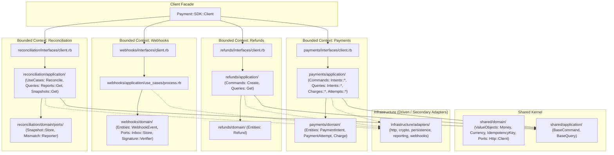

# Roadmap 002: Reorganización Context-First, Estandarización `#call`, Auditoría y Release

Este documento define la fase estratégica de consolidación y perfeccionamiento arquitectónico del SDK `Payment::SDK` tras la sesión interactiva de diseño (`/grill-me`). Su objetivo es llevar el codebase a un estándar de grado enterprise, adoptando una estructura **Context-First** a nivel raíz, unificando la interfaz de ejecución bajo el protocolo idiomático `#call`, normalizando los estados del dominio a **Symbols**, eliminando residuos manuales, y documentando formalmente tanto la auditoría técnica como el árbol canónico y su plantilla arquetípica.

---

## 1. Decisiones Arquitectónicas Clave (Derivadas de `/grill-me`)

| Aspecto | Decisión Acordada | Justificación Técnica |
| :--- | :--- | :--- |
| **Organización de Carpetas** | **Context-First** en la raíz: `lib/payment/sdk/<context>/{domain, application, interfaces}/` | Máxima cohesión por Bounded Context. Cada contexto encapsula sus entidades, casos de uso/comandos e interfaces. Permite extraer contextos a gemas o servicios independientes en el futuro sin reestructurar capas. |
| **Protocolo de Invocación** | **Estandarización a `#call`** en Commands, Queries y Use Cases | Es el protocolo estándar universal en Ruby para objetos invocables (*Callables*: `Proc`, `Lambda`, Interactors, Service Objects). Habilita sintaxis `obj.(...)`, compatibilidad con `&obj` y polimorfismo funcional sin sobrecarga cognitiva. |
| **Tipado de Estados y Enums** | **Normalización a Symbols** en todo el Dominio (`:succeeded`, `:requires_capture`, etc.) | Comparaciones $O(1)$ por igualdad de puntero, inmutabilidad garantizada, integración óptima con pattern matching de Ruby 3+. Los bordes del sistema (HTTP/JSON) convierten entradas a símbolos de forma segura. |
| **Directorio `examples/`** | **Eliminación completa** | Evita scripts manuales no verificados por CI. Los flujos de ejemplo y quickstart se documentan con código ejecutable verificado directamente en el `README.md`. |
| **Documentación de Árbol** | **`TREE.txt` comentado línea a línea** y **`TREE_TEMPLATE.txt` arquetípico** | Cada línea de `TREE.txt` contendrá un comentario `#` alineado explicando su responsabilidad única. `TREE_TEMPLATE.txt` servirá de plantilla de diseño para nuevos Bounded Contexts. |
| **Auditoría y `README.md`** | **Reporte formal en `docs/audit/`** y **`README.md` enterprise indexado** | Documentación exhaustiva para Engineering Managers y Tech Leads sobre deuda técnica, concurrencia, resiliencia y roadmap evolutivo. |

---

## 2. Mapa Arquitectónico Objetivo (Context-First)

---

## 3. Fases de Ejecución Detalladas (Checklist de Tareas)

### Fase 1: Reorganización Context-First en `lib/` y `test/`
- [x] **1.1 Bounded Context `payments`**:
  - [x] Mover dominio: `lib/payment/sdk/payments/domain/entities/{payment_intent,payment_attempt,charge}.rb`.
  - [x] Mover aplicación: `lib/payment/sdk/payments/application/commands/intents/` y `queries/{intents,charges,attempts,lifecycles}/`.
  - [x] Mover interfaz: `lib/payment/sdk/payments/interfaces/client.rb`.
  - [x] Mover tests espejo: `test/payment/sdk/payments/{domain,application,interfaces}/`.
- [x] **1.2 Bounded Context `refunds`**:
  - [x] Mover dominio: `lib/payment/sdk/refunds/domain/entities/refund.rb`.
  - [x] Mover aplicación: `lib/payment/sdk/refunds/application/commands/create.rb` y `queries/get.rb`.
  - [x] Mover interfaz: `lib/payment/sdk/refunds/interfaces/client.rb`.
  - [x] Mover tests espejo: `test/payment/sdk/refunds/{domain,application,interfaces}/`.
- [x] **1.3 Bounded Context `webhooks`**:
  - [x] Mover dominio: `lib/payment/sdk/webhooks/domain/entities/webhook_event.rb` y `ports/{inbox/store,signature/verifier}.rb`.
  - [x] Mover aplicación: `lib/payment/sdk/webhooks/application/use_cases/process.rb`.
  - [x] Mover interfaz: `lib/payment/sdk/webhooks/interfaces/client.rb`.
  - [x] Mover tests espejo: `test/payment/sdk/webhooks/{domain,application,interfaces}/`.
- [x] **1.4 Bounded Context `reconciliation`**:
  - [x] Mover dominio: `lib/payment/sdk/reconciliation/domain/ports/{snapshot/store,mismatch/reporter}.rb`.
  - [x] Mover aplicación: `lib/payment/sdk/reconciliation/application/use_cases/reconcile.rb` y `queries/{reports,snapshots}/`.
  - [x] Mover interfaz: `lib/payment/sdk/reconciliation/interfaces/client.rb`.
  - [x] Mover tests espejo: `test/payment/sdk/reconciliation/{domain,application,interfaces}/`.
- [x] **1.5 Shared Kernel**:
  - [x] Mover dominio compartido: `lib/payment/sdk/shared/domain/value_objects/` y `ports/http/client.rb`.
  - [x] Mover aplicación compartida: `lib/payment/sdk/shared/application/{base_command,base_query}.rb`.
  - [x] Mover tests espejo: `test/payment/sdk/shared/{domain,application}/`.
- [x] **1.6 Adaptadores Secundarios**:
  - [x] Consolidar adaptadores conducidos en `lib/payment/sdk/infrastructure/adapters/`.
  - [x] Consolidar tests en `test/payment/sdk/infrastructure/adapters/`.
- [x] **1.7 Actualizar Fachada Raíz**:
  - [x] Actualizar `lib/payment/sdk/client.rb` con las nuevas rutas de requires y namespaces.
- [x] **1.8 Validación**:
  - [x] Ejecutar `bundle exec rake test` (100% verde).

---

### Fase 2: Estandarización a `#call` y Normalización a Symbols
- [x] **2.1 Estandarización a `#call`**:
  - [x] `Shared::Application::BaseCommand`: definir método abstracto `#call(**opts)`.
  - [x] `Shared::Application::BaseQuery`: definir método abstracto `#call(**opts)`.
  - [x] Refactorizar todos los comandos de pagos y reembolsos a `def call(...)`.
  - [x] Refactorizar todas las queries de pagos, reembolsos y reconciliación a `def call(...)`.
  - [x] Actualizar invocaciones en sub-clientes (`Payments::Interfaces::Client`, `Refunds::Interfaces::Client`, etc.) para invocar `.call(...)`.
  - [x] Actualizar todos los tests unitarios correspondientes.
- [x] **2.2 Normalización a Symbols en Dominio**:
  - [x] `PaymentIntent`: normalizar `@status = status.to_sym` y métodos de consulta (`requires_capture?`, `succeeded?`, etc.).
  - [x] `PaymentAttempt`: normalizar `@status = status.to_sym`.
  - [x] `Charge`: normalizar `@status = status.to_sym`.
  - [x] `Refund`: normalizar `@status = status.to_sym`.
  - [x] Adaptadores HTTP y EventParser: asegurar conversión limpia de payloads remotos hacia el dominio.
  - [x] Actualizar assertions de tests para validar tipos de estado consistentes.
- [x] **2.3 Validación**:
  - [x] Ejecutar `bundle exec rake test` (100% verde sin advertencias).

---

### Fase 3: Eliminación de `examples/` y Limpieza de Residuos
- [ ] **3.1** Eliminar `examples/smoke_test.rb` y el directorio `examples/`.
- [ ] **3.2** Asegurar que ningún script ni test dependa de rutas temporales o dobles manuales en desuso.
- [ ] **3.3** Verificar que no queden carpetas vacías ni archivos residuales con `git status`.

---

### Fase 4: Documentación Canónica: `TREE.txt` y `TREE_TEMPLATE.txt`
- [ ] **4.1** Generar `TREE.txt` anotando **cada línea** con un comentario `#` perfectamente alineado indicando su responsabilidad arquitectónica única.
- [ ] **4.2** Crear `TREE_TEMPLATE.txt` con el arquetipo exhaustivo de un Bounded Context en Clean Architecture (detallando capas, nombres sugeridos y responsabilidades de cada componente para futuros módulos).

---

### Fase 5: Auditoría Técnica Exhaustiva y Reescritura Enterprise de `README.md`
- [ ] **5.1 Auditoría Técnica (`docs/audit/001-codebase_technical_audit.md`)**:
  - [ ] Análisis de deuda técnica y trade-offs asumidos.
  - [ ] Análisis de concurrencia y thread-safety (Mutex, aislamiento de estado mutable, connection pooling).
  - [ ] Análisis de resiliencia (políticas de reintento, timeout handling, circuit breakers).
  - [ ] Estrategia de observabilidad y telemetría (logging contextual, OpenTelemetry spans, métricas de latencia).
  - [ ] Matriz de dependencias y compatibilidad con versiones de Ruby (3.2+, 3.3, 4.0).
  - [ ] Roadmap de mejoras técnicas priorizadas (P0 a P3).
- [ ] **5.2 Reescritura Enterprise del `README.md`**:
  - [ ] Badges de estado, compatibilidad y cobertura.
  - [ ] Índice numerado formal.
  - [ ] Guía de instalación y configuración segura.
  - [ ] Ejemplos de uso ejecutables por Bounded Context (Payments, Refunds, Webhooks, Reconciliation).
  - [ ] Arquitectura y diseño del sistema con diagrama.
  - [ ] Guía para colaboradores (testing, linter, estándares).

---

### Fase 6: Validación Final de Calidad y Commit
- [ ] **6.1** Ejecutar `bundle exec rake test` (todas las pruebas pasando al 100% con 0 errores y 0 warnings).
- [ ] **6.2** Marcar todos los ítems del roadmap como completados.
- [ ] **6.3** Crear commit semántico: `feat(architecture): migrate to context-first layout, standardize #call, add technical audit and enterprise docs`.
