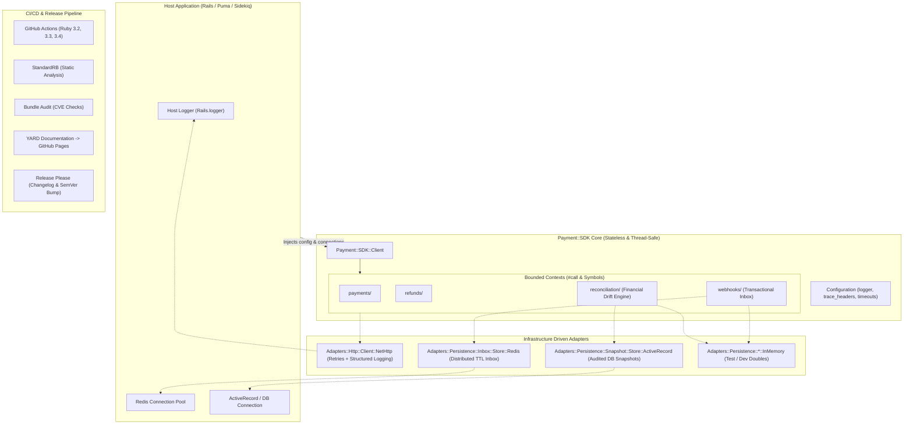

# Roadmap 003: CI/CD, Observabilidad Enterprise y Persistencia Distribuida

Este roadmap formaliza el siguiente gran salto evolutivo de la gema `Payment::SDK` tras la sesión de arquitectura interactiva (`/grill-me`). Su propósito es llevar el SDK a un nivel de madurez operativa y de ingeniería de grado enterprise, incorporando automatización de releases, documentación YARD, pipeline de integración continua robusto, observabilidad estructurada y adaptadores de persistencia para entornos de producción concurrentes y distribuidos.

---

## 1. Decisiones Clave Acordadas (`/grill-me`)

| Dimensión | Decisión Adoptada | Justificación Técnica |
| :--- | :--- | :--- |
| **Secuencia de Fases** | **1. YARD & Release → 2. CI/CD StandardRB → 3. Observabilidad → 4. Adaptadores** | Definido expresamente por el usuario para establecer primero las bases de release y calidad antes de extender capacidades técnicas. |
| **Documentación API** | **YARD con `.yardopts`, tarea `rake yard` y GitHub Pages** | Generación de documentación estandarizada de tipos y parámetros, desplegada automáticamente en la rama `gh-pages` ante pushes a `main`. |
| **Automatización de Release** | **Híbrido Enterprise: `release-please` (Conventional Commits)** | Automatiza la creación de Release PRs, cálculo de versión semántica en `version.rb`, generación de `CHANGELOG.md` y publicación de releases al mergear. |
| **Calidad de Código y CI** | **StandardRB + Matriz Multi-Ruby (3.2, 3.3, 3.4)** | Reglas estrictas sin debate de configuración (*zero-configuration*), combinado con `bundle-audit` para CVEs y verificación de empaquetado `gem build`. |
| **Observabilidad y Telemetría** | **`config.logger` estructurado + Trazas W3C agnósticas** | Inyección de logger (`Logger`, `Rails.logger`), logueo estructurado de peticiones HTTP (latencia, status, sanitización de credenciales) y propagación de cabeceras de trazabilidad (`traceparent`, `X-Request-Id`) sin añadir gemas pesadas en runtime. |
| **Persistencia Distribuida** | **Adaptadores conducidos pluggables (Redis y SQL/ActiveRecord)** | Implementaciones de `Inbox::Store` y `Snapshot::Store` por *duck-typing* que reciben la conexión del host (ej. `redis_client`), preservando la política de cero dependencias obligatorias en el `gemspec`. |

---

## 2. Diagrama Arquitectónico Objetivo (Fase Enterprise)

---

## 3. Fases de Ejecución Detalladas (Checklist de Tareas)

### Fase 1: Documentación API con YARD y Release Automation
- [x] **1.1 Configuración de YARD**:
  - [x] Agregar `gem "yard"` en el grupo de desarrollo en `Gemfile`.
  - [x] Crear archivo `.yardopts` configurando títulos, formato markdown y exclusión de tests.
  - [x] Agregar tarea `rake yard` en `Rakefile`.
  - [x] Documentar con tags YARD (`@param`, `@return`, `@raise`) las clases públicas fundamentales (`Client`, entidades y sub-clientes) alcanzando **100.00% de cobertura YARD** con `--fail-on-warning`.
- [x] **1.2 Pipeline de GitHub Pages**:
  - [x] Crear workflow `.github/workflows/documentation.yml` para compilar y desplegar YARD docs en GitHub Pages en push a `main`.
- [x] **1.3 Automatización de Release con `release-please`**:
  - [x] Crear configuración `.release-please-config.json` y `.release-please-manifest.json`.
  - [x] Crear workflow `.github/workflows/release.yml` integrando `googleapis/release-please-action`.
  - [x] Inicializar `CHANGELOG.md` con el estándar *Keep a Changelog* documentando las versiones 0.1.0 y cambios actuales.

---

### Fase 2: Pipeline de CI/CD Completo (StandardRB y Multi-Ruby)
- [x] **2.1 Configuración de StandardRB**:
  - [x] Agregar `gem "standard"` en `Gemfile` (grupo `:development, :test`).
  - [x] Ejecutar `bundle exec standardrb` y formatear el código si fuera necesario (`--fix`).
  - [x] Agregar tarea de linter a la ejecución por defecto de Rake.
- [x] **2.2 Auditoría de Seguridad y Empaquetado**:
  - [x] Agregar `gem "bundler-audit"` para detección de CVEs.
  - [x] Crear tarea Rake `rake audit` y `rake build` para validar el empaquetado del `.gem`.
- [x] **2.3 Workflow de CI en GitHub Actions**:
  - [x] Crear `.github/workflows/ci.yml` con matriz de prueba:
    - Versiones de Ruby: `3.2`, `3.3`, `3.4`.
    - Pasos: Checkout, Setup Ruby, Bundle Install, `standardrb`, `bundle-audit`, `rake test`, y `gem build`.

---

### Fase 3: Observabilidad y Telemetría Enterprise
- [x] **3.1 Logger Contextual Inyectable**:
  - [x] Extender `Configuration` con `attr_accessor :logger, :log_level`.
  - [x] Implementar decorador/helper de logging interno seguro que sanitice tokens y headers sensibles (Authorization, Signing Secret).
  - [x] Instrumentar el cliente HTTP (`NetHttp`) para registrar eventos estructurados en formato clave-valor o JSON (método, URL sanitizada, código de respuesta, duración en milisegundos).
- [x] **3.2 Propagación de Trazabilidad Distribuida (W3C Trace Context)**:
  - [x] Permitir inyección de `traceparent` o `request_id` en las opciones de comandos y llamadas HTTP.
  - [x] Propagar cabeceras `traceparent` y `X-Request-Id` hacia las peticiones de red salientes.
- [x] **3.3 Tests Espejo y Verificación**:
  - [x] Tests unitarios para el comportamiento del logger y la sanitización de secretos.
  - [x] Tests para la propagación de cabeceras de trazabilidad.

---

### Fase 4: Adaptadores Conducidos de Persistencia Distribuida
- [x] **4.1 Adaptador `Inbox::Store::Redis`**:
  - [x] Crear `lib/payment/sdk/infrastructure/adapters/persistence/inbox/store/redis.rb` implementando el puerto `Webhooks::Domain::Ports::Inbox::Store`.
  - [x] Soportar operaciones atómicas con TTL configurable para evitar saturación de memoria.
  - [x] Diseñado mediante *duck-typing* para aceptar cualquier cliente compatible con Redis (ej. `redis`, `redis-client`).
- [x] **4.2 Adaptador `Snapshot::Store::ActiveRecord` / `SQL`**:
  - [x] Crear `lib/payment/sdk/infrastructure/adapters/persistence/snapshot/store/active_record.rb` implementando el puerto `Reconciliation::Domain::Ports::Snapshot::Store`.
  - [x] Mapeo transparente entre entidades de dominio y registros de base de datos relacional.
- [x] **4.3 Tests Espejo y Mocks**:
  - [x] Pruebas unitarias completas con dobles de prueba sin exigir Redis ni DB local corriendo para pasar la suite.

---

### Fase 5: Suite de Integración E2E Enterprise (Testcontainers & Sandbox Container)
- [x] **5.1 Dependencias y Helper de Testcontainers**:
  - [x] Agregar `gem "testcontainers"` en `:development, :test` en `Gemfile`.
  - [x] Crear `test/integration_helper.rb` para orquestar programáticamente el contenedor `angelszymczak/payment-sandbox` (asignación dinámica de puertos y wait-for-health contra `/v1/reports/transactions`).
- [x] **5.2 Flujos E2E del Ciclo de Vida Completo**:
  - [x] Test E2E 1: Creación y confirmación automática (`create_payment_intent` con `capture_method: "automatic"` -> `confirm_payment_intent` -> verificación de estado `succeeded`, inspección de `charge`, `payment_attempt` y `lifecycle`).
  - [x] Test E2E 2: Creación manual y captura en dos pasos (`create_payment_intent` con `capture_method: "manual"` -> `confirm_payment_intent` -> `requires_capture` -> `capture_payment_intent` -> `succeeded`).
  - [x] Test E2E 3: Reembolsos reales (`create_refund` sobre el charge capturado -> verificar `status: "succeeded"` -> `get_refund`).
- [x] **5.3 Escenarios Exhaustivos (Sandbox Scenarios, Idempotencia y Concurrencia)**:
  - [x] Test E2E 4: Simulación de fallo bancario con cabecera `X-Sandbox-Scenario: declined` -> verificar mapeo de error a `PaymentDeclinedError`.
  - [x] Test E2E 5: Idempotencia estricta en el servidor real: re-envío de peticiones con el mismo `Idempotency-Key` sin duplicación de cobros ni efectos colaterales.
  - [x] Test E2E 6: Concurrencia multi-hilo emitiendo transacciones en paralelo contra el sandbox real.
- [x] **5.4 Conciliación Real E2E**:
  - [x] Test E2E 7: Ejecución de `reconcile` contra el endpoint real `/v1/reports/transactions?view=snapshot`, validando match y reporte de discrepancias.
- [x] **5.5 Orquestación y CI con Cache de Docker**:
  - [x] Agregar tarea `rake test:integration` en `Rakefile`.
  - [x] Agregar job dedicado `integration` en `.github/workflows/ci.yml` con `actions/cache@v4` para almacenar y restaurar el tarball de la imagen Docker de `angelszymczak/payment-sandbox`.

---

### Fase 6: Documentación, Actualización del Árbol y Release
- [ ] **6.1 Actualización de `TREE.txt`**:
  - [ ] Regenerar `TREE.txt` con todas las nuevas rutas (`test/integration/`, adaptadores, workflows) alineadas a la columna 68.
- [ ] **6.2 Actualización de `README.md` y `docs/audit/`**:
  - [ ] Documentar en `README.md` la suite de pruebas E2E con Testcontainers, adaptadores de Redis y ActiveRecord y observabilidad.
  - [ ] Actualizar `001-codebase_technical_audit.md` reflejando la completitud de la pirámide de pruebas.
- [ ] **6.3 Validación Integral y Commit de Release**:
  - [ ] Ejecutar `bundle exec rake test` (100% verde).
  - [ ] Ejecutar `bundle exec standardrb` (0 ofensas).
  - [ ] Ejecutar `bundle exec rake yard` (100.00% documentado, 0 warnings).
  - [ ] Ejecutar `gem build payment-sdk.gemspec` (empaquetado limpio sin warnings).
  - [ ] Ejecutar `bundle exec rake audit` (0 vulnerabilidades).
- [ ] **6.4 Commit y Tag Semántico de Release**.
