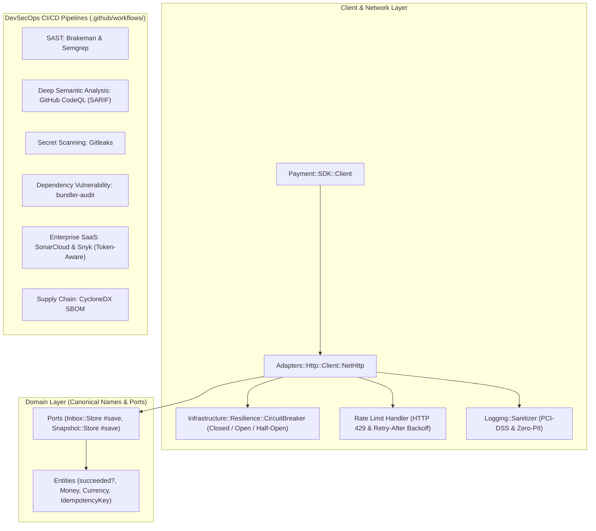

# Roadmap 004: Hardening de Seguridad, Resiliencia de Runtime y Pipeline DevSecOps

Este roadmap formaliza la siguiente evolución estratégica de la gema `Payment::SDK` tras la sesión de arquitectura interactiva (`/grill-me`). Su objetivo es blindar la gema en los tres ejes críticos para plataformas de pagos enterprise:
1. **Auditoría Interna y Limpieza de Código**: Purga de alias residuales, estandarización estricta de nombres y namespaces, y eliminación de cualquier archivo o carpeta obsoleta.
2. **Resiliencia y Hardening de Runtime**: Manejo reactivo de Rate Limiting (HTTP 429 con `Retry-After`), Circuit Breaker nativo thread-safe (zero dependencies), desalojo por TTL en stores de memoria y política Zero-PII en excepciones y logs.
3. **Pipeline DevSecOps Multi-Capa**: Análisis estático (SAST con Brakeman y Semgrep), análisis semántico profundo con GitHub CodeQL y SARIF, escaneo de secretos (Gitleaks), análisis de composición (SCA con bundler-audit), plantillas preparadas para SaaS (SonarQube/SonarCloud y Snyk) y generación de SBOM.

---

## 1. Decisiones Clave Acordadas (`/grill-me`)

| Dimensión | Decisión Adoptada | Justificación Técnica |
| :--- | :--- | :--- |
| **Enfoque de Ejecución** | **Holístico por 4 Fases Secuenciales** | 1) Limpieza interna de código $\to$ 2) Resiliencia de runtime $\to$ 3) DevSecOps en CI $\to$ 4) Documentación y auditoría canónica. |
| **Política de Alias** | **Purga y Unificación Estricta (Breaking Cleanliness)** | Estandarizar un único nombre canónico por concepto (`#save`, `#succeeded?`, `#get_transaction_snapshot`), purgando alias invertidos o redundantes antes de `v1.0.0`. |
| **Resiliencia de Runtime** | **Dual: Rate Limiter 429 + Circuit Breaker Nativo** | Manejo inteligente de `Retry-After` con backoff y máquina de estados `:closed`, `:open`, `:half_open` con umbrales configurables sin dependencias externas. |
| **Protección de Datos** | **Hardening Integral de Datos Sensibles (Zero-PII)** | TTL automático en `InMemory` store para mitigar DoS, sanitización recursiva de payloads en excepciones (`ApiError#raw_body` y `details`) y blindaje de secretos. |
| **Scanners de Seguridad** | **Híbrido DevSecOps: Nativos Incondicionales + SaaS Condicional** | Scanners locales y de GitHub (CodeQL, Brakeman, Semgrep, Gitleaks, bundler-audit) como bloqueantes obligatorios; SonarQube y Snyk ejecutables con tokens. |

---

## 2. Diagrama Arquitectónico Objetivo (DevSecOps & Resiliencia)

---

## 3. Desglose Detallado de Fases y Tareas

### Fase 1: Auditoría de Código, Purga de Alias y Normalización de Namespaces
- [x] **1.1 Auditoría y Estandarización de Métodos Persistentes**:
  - [x] Estandarizar `save(entry)` en `lib/payment/sdk/infrastructure/adapters/persistence/inbox/store/in_memory.rb` (reemplazando `persist` como método primario y eliminando el alias).
  - [x] Eliminar `alias_method :persist, :save` en `lib/payment/sdk/infrastructure/adapters/persistence/inbox/store/redis.rb`.
  - [x] Actualizar pruebas unitarias en `test/payment/sdk/infrastructure/adapters/persistence/inbox/store/` para invocar `#save`.
- [x] **1.2 Normalización de Predicados de Dominio**:
  - [x] Normalizar `PaymentAttempt#succeeded?` en `lib/payment/sdk/payments/domain/entities/payment_attempt.rb` (eliminando `successful?` y su alias redundante).
  - [x] Actualizar pruebas unitarias en `test/payment/sdk/payments/domain/entities/payment_attempt_test.rb`.
- [x] **1.3 Normalización de Interfaces de Conciliación**:
  - [x] En `lib/payment/sdk/reconciliation/interfaces/client.rb`, renombrar `get_report` y `get_snapshot` a `get_transaction_report` y `get_transaction_snapshot` como métodos canónicos y eliminar los alias.
  - [x] Actualizar llamadas internas en `Client#get_transaction_report` y pruebas unitarias de reconciliación.
- [x] **1.4 Limpieza de Artefactos y Verificación de Consistencia de Namespaces**:
  - [x] Auditar el árbol completo en busca de carpetas huérfanas, archivos temporales o discrepancias de nombres.
  - [x] Ejecutar `bundle exec rake test`, `bundle exec rake test:integration`, `bundle exec standardrb` y `bundle exec rake yard`.
  - [x] Crear informe de auditoría `docs/audit/002-security_resilience_and_devsecops_audit.md`.

---

### Fase 2: Resiliencia de Runtime (Rate Limiting, Circuit Breaker, TTL y Zero-PII)
- [x] **2.1 Manejo Reactivo de Rate Limiting (HTTP 429)**:
  - [x] Crear excepción especializada `Payment::SDK::RateLimitError < ApiError` con lector `retry_after_seconds`.
  - [x] Extender `Infrastructure::Adapters::Http::ErrorMapper` para mapear HTTP 429 a `RateLimitError`.
  - [x] Implementar parseo de `Retry-After` (soporta enteros en segundos y fechas RFC 7231) en `NetHttp`.
  - [x] Añadir soporte de reintento automático respetando `retry_after_seconds` si es menor o igual a un umbral configurable (`rate_limit_max_delay`, default: 10s).
- [x] **2.2 Circuit Breaker Nativo Thread-Safe**:
  - [x] Crear `lib/payment/sdk/infrastructure/resilience/circuit_breaker.rb` con estados `:closed`, `:open`, `:half_open`.
  - [x] Exponer configuración en `Payment::SDK::Configuration`:
    - `circuit_breaker_enabled` (default: `true`)
    - `circuit_breaker_failure_threshold` (default: `5` fallos consecutivos de 5xx o timeout)
    - `circuit_breaker_reset_timeout` (default: `30` segundos)
  - [x] Crear excepción `Payment::SDK::CircuitBreakerOpenError < Error`.
  - [x] Integrar el Circuit Breaker en `NetHttp#perform_request` con sincronización de mutex.
- [x] **2.3 TTL y Desalojo de Memoria en `Inbox::Store::InMemory`**:
  - [x] Añadir soporte opcional de `ttl_seconds` con barrido automático ante consultas o escrituras para evitar DoS por saturación de RAM.
- [x] **2.4 Política Zero-PII en Excepciones y Logging**:
  - [x] Sanitizar campos sensibles en `ApiError#initialize` (`raw_body` y `details`) utilizando `Sanitizer`.
  - [x] Pruebas unitarias completas de Rate Limiting, Circuit Breaker, TTL y Zero-PII.

---

### Fase 3: Pipeline DevSecOps Multi-Capa (CI/CD)
- [x] **3.1 Scanners SAST Nativos**:
  - [x] Agregar gema `brakeman` en `:development, :test` del `Gemfile` y tarea `rake security:brakeman`.
  - [x] Configurar job de GitHub Actions para ejecutar `Brakeman` con umbral de fallo en warnings de alta/media severidad.
  - [x] Configurar step o workflow para `Semgrep` con reglas comunitarias `p/ruby`, `p/owasp-top-ten` y `p/cwe-top-25`.
- [x] **3.2 Análisis Semántico GitHub CodeQL**:
  - [x] Crear workflow `.github/workflows/codeql.yml` para compilar la base de datos de CodeQL para Ruby y subir los resultados SARIF a la pestaña de Seguridad.
- [x] **3.3 Escaneo de Secretos con Gitleaks**:
  - [x] Integrar step de `Gitleaks` en GitHub Actions para verificar que ningún commit contenga claves privadas, tokens de sandbox o contraseñas reales.
- [x] **3.4 Integración SaaS (SonarQube/SonarCloud & Snyk)**:
  - [x] Crear `.github/workflows/security.yml` con jobs preparados para SonarCloud y Snyk con condicionales `if: env.SONAR_TOKEN != ''` y `if: env.SNYK_TOKEN != ''`.
- [x] **3.5 Supply Chain Security & SBOM**:
  - [x] Agregar generación de SBOM (Software Bill of Materials) en formato CycloneDX via GitHub Actions.

---

### Fase 4: Documentación Canónica, Actualización de TREE.txt y Release
- [x] **4.1 Actualización de `TREE.txt`**:
  - [x] Regenerar árbol canónico con nuevos archivos de resiliencia (`resilience/circuit_breaker.rb`), workflows y pruebas alineados estrictamente en columna 69.
- [x] **4.2 Actualización de `README.md`**:
  - [x] Documentar Circuit Breaker, Rate Limiting (429), Zero-PII y la suite de seguridad DevSecOps.
- [x] **4.3 Auditoría Técnica Final**:
  - [x] Completar `docs/audit/002-security_resilience_and_devsecops_audit.md`.
- [x] **4.4 Validación Integral y Commit Semántico**:
  - [x] `rake test` (100% verde).
  - [x] `rake test:integration` (100% verde).
  - [x] `standardrb` (0 ofensas).
  - [x] `rake yard` (100.00% documentado, 0 warnings).
  - [x] `bundle-audit` y `brakeman` (0 vulnerabilidades).
  - [x] `gem build payment-sdk.gemspec` (empaquetado limpio sin warnings).
